# ロードマップ

このロードマップはreleaseと製品採用順の正本サマリーです。実装の
source of truth は code・test・package とリンクされた Issue であり、個別の
Acceptance Criteria を置き換えません。

## 1. Product thesis

`cdn-security-framework` は **Application-aware Edge Security Compiler** です。
宣言 API、実装 source、許可 policy 面、実行時 evidence を比較し、人が
review した policy だけを CDN / edge / WAF artifact へ compile します。

CDN、WAF、DDoS、bot、CAPTCHA engine 自体を再実装しません。Product loop は
**Generate → Diff → Review → Apply** です。AI は finding の説明だけを行い、
Allow / Block / Severity / Exit を決定しません。

上記はProductの方向です。現在の比較経路とPlannedの境界は次の状態表を参照してください。

## 2. 4つの Truth と Evidence

| View | Source | 意味 |
| --- | --- | --- |
| Declared API | OpenAPI | チームが宣言した API |
| Implemented API | Source AST | source から静的に確認できる API |
| Allowed API | Security Policy / CDN / WAF | edge が許可するよう設定された面 |
| Observed Evidence | Runtime security event | 実行時に観測された security decision |

これらを暗黙に統合したり優先順位で上書きしたりしません。不一致は決定論的な
finding として返します。Runtime に観測がないことは route 削除・enforce の根拠に
ならず、guard がないことも public access の証明ではありません。

## 3. 現行リリースと main の状態

2026-10-26に照合した技術基準はmain `31975ebcf9862ba040905c1a693fe17714b5a5fd`です。公開済み **1.4.0 / Policy schema 1**、未公開 **2.0.0-rc.0 / Policy schema 2**、将来の正式 **2.0.0**は別状態です。[main artifactの独立照合](quickstart.ja.md#1-未公開schema2候補を空のconsumerへ導入)を使い、最終source/harness/tree/run/attempt/tgz/lockをpackage外の[#1024](https://github.com/albert-einshutoin/cdn-security-framework/issues/1024)へ固定します。同梱docsへ最終tgz自身のhashを固定しません。

下表の2026-09-22/main111f995へのlinkは過去の基盤実装の証拠です。追加した有界modelとlocal artifact検証は、それぞれ#1119/#1123の受入記録に範囲を固定しています。Phase全体の完了・実Cloud・H01・RC GO・公開へ拡大しません。

| Area | Status | Evidence / boundary |
| --- | --- | --- |
| Released package | v1.4.0 | [v1.4.0 tag](https://github.com/albert-einshutoin/cdn-security-framework/releases/tag/v1.4.0) |
| Contract / trust foundation (#271–#275) | Implemented | [Contract tests](https://github.com/albert-einshutoin/cdn-security-framework/tree/111f995bd35d3b24bdd1ee7dd72c35bce19f9170/test/contract/) / [Public contract](./programmatic-api.ja.md) |
| OpenAPI-aware policy (#276–#284) | Implemented | [OpenAPI tests](https://github.com/albert-einshutoin/cdn-security-framework/tree/111f995bd35d3b24bdd1ee7dd72c35bce19f9170/test/openapi/) / [OpenAPI guide](./openapi-integration.ja.md) |
| Declared ↔ allowed drift (#285–#293) | Implemented | [Drift tests](https://github.com/albert-einshutoin/cdn-security-framework/tree/111f995bd35d3b24bdd1ee7dd72c35bce19f9170/test/contract/contract-drift.test.ts) / [Reporters](https://github.com/albert-einshutoin/cdn-security-framework/tree/111f995bd35d3b24bdd1ee7dd72c35bce19f9170/test/reporters/) |
| NestJS Source Analyzer core (#294–#300) | Implemented / Experimental | [Source guide](./source-analysis-nestjs.ja.md); programmatic/static only |
| Source-aware standard CLI | Planned v2.1.0 | [#531](https://github.com/albert-einshutoin/cdn-security-framework/issues/531) |
| Policy schema 2 / migration | Implemented on main / unpublished | [#1023](https://github.com/albert-einshutoin/cdn-security-framework/issues/1023) / [PR #1033](https://github.com/albert-einshutoin/cdn-security-framework/pull/1033) |
| Auth/cache verification model | Implemented bounded/internal core on main; unpublished | [#1119](https://github.com/albert-einshutoin/cdn-security-framework/issues/1119) / [PR #1122](https://github.com/albert-einshutoin/cdn-security-framework/pull/1122); model-only verdict and independent witness, no deployed auth proof |
| Cloudflare artifact HTTP verification | Implemented bounded/local MVP on main; unpublished | [#1123](https://github.com/albert-einshutoin/cdn-security-framework/issues/1123) / [PR #1124](https://github.com/albert-einshutoin/cdn-security-framework/pull/1124); bound artifact/runtime and independent local HTTP oracle, no live Cloud or AWS cache proof |
| Next.js dependency-aware guard / diagnostics | Implemented on main; unpublished | [PR #1121](https://github.com/albert-einshutoin/cdn-security-framework/pull/1121) / [#1125](https://github.com/albert-einshutoin/cdn-security-framework/issues/1125); only CVE-2025-29927 generates a guard, five additional advisories are diagnostic only; adoption remains [#1120](https://github.com/albert-einshutoin/cdn-security-framework/issues/1120) |
| v2.0 release preparation | Operational hardening / not RC GO | [#529](https://github.com/albert-einshutoin/cdn-security-framework/issues/529) / [#895](https://github.com/albert-einshutoin/cdn-security-framework/issues/895) |

## 4. Version Release Train

Phaseはrelease版ではありません。v2.1後の版と日付は未採用で、旧milestone名から推測しません。製品採用のEntry・互換性・pilot・費用・Midpoint/RC判断は[#270](https://github.com/albert-einshutoin/cdn-security-framework/issues/270)と[#872](https://github.com/albert-einshutoin/cdn-security-framework/issues/872)が正本です。

| Release / phase | Canonical owner | Outcome | Entry / status |
| --- | --- | --- | --- |
| v2.0.0 | [#529](https://github.com/albert-einshutoin/cdn-security-framework/issues/529) | Contract Foundation / schema 2 / safe migration | Operational hardening; H01 / #1024 / #542 / #895 / #571 gates remain |
| v2.1.0 | [#531](https://github.com/albert-einshutoin/cdn-security-framework/issues/531) | Source-aware Contract Diff MVP | Planned product; #545 Entry, pilot and release gates remain. [PR #1090](https://github.com/albert-einshutoin/cdn-security-framework/pull/1090) is merged into dev/2.1-source-aware, not main |
| A | [#533](https://github.com/albert-einshutoin/cdn-security-framework/issues/533) | Verification Core / accuracy and onboarding hardening | Bounded #1119 core implemented; product adoption and remaining hardening planned after #531 post-release review |
| B | [#534](https://github.com/albert-einshutoin/cdn-security-framework/issues/534) | Runtime / Artifact & Deployment Verification | Bounded #1123 local artifact MVP implemented; remaining event/deployment scope planned; A contract and adoption Entry |
| C | [#1118](https://github.com/albert-einshutoin/cdn-security-framework/issues/1118) | Security Equivalence, common AWS/Cloudflare subset | Planned; adopted A/B model and evidence contracts; equivalence is not safety |
| D | [#536](https://github.com/albert-einshutoin/cdn-security-framework/issues/536) | CI Regression Guard / composition and governance | Planned; adopted A → B → C; no silent weakening or automatic apply |
| GA | [#537](https://github.com/albert-einshutoin/cdn-security-framework/issues/537) | Public Contract / Provider maturity | Planned after A → B → C → D; version not adopted |
| Optional after GA | [#539](https://github.com/albert-einshutoin/cdn-security-framework/issues/539) | Editor / LSP / VS Code | Not adopted; real demand and GA Entry; not a GA prerequisite |

#1119/#1123は明示された有界scopeでmain受入済みの技術成果です。製品採用順やH01・公開Gateを免除せず、#533/#534のpilot、精度/導入、event/deployment等の残るACを完了にしません。独立した試作は明示scopeで進められますが、Verifierを#529/#531の新しい公開前提にはしません。

## 5. Version dependency graph

```mermaid
flowchart LR
  CF["#529 Contract Foundation"] --> PUB["#571 Publication"]
  PUB --> POST["#545 Post-release"]
  POST --> SA["#531 Source-aware MVP / post-release"]
  SA --> A["#533 A: Verification Core"]
  A --> B["#534 B: Artifact / Deployment"]
  B --> C["#1118 C: Equivalence"]
  C --> D["#536 D: Regression / Governance"]
  D --> GA["#537 GA"]
  GA --> ED["#539 Optional Editor"]
```

## 6. Review cadence と release gate

1. Entry / evidence review: [#541](https://github.com/albert-einshutoin/cdn-security-framework/issues/541).
2. Current candidate audits: [#887](https://github.com/albert-einshutoin/cdn-security-framework/issues/887), [#889](https://github.com/albert-einshutoin/cdn-security-framework/issues/889), [#891](https://github.com/albert-einshutoin/cdn-security-framework/issues/891), [#890](https://github.com/albert-einshutoin/cdn-security-framework/issues/890), [#1024](https://github.com/albert-einshutoin/cdn-security-framework/issues/1024).
3. Midpoint / implementation-status review: [#542](https://github.com/albert-einshutoin/cdn-security-framework/issues/542).
4. RC GO/NO-GO: [#895](https://github.com/albert-einshutoin/cdn-security-framework/issues/895).
5. Version change / release preparation / separately approved publication: [#571](https://github.com/albert-einshutoin/cdn-security-framework/issues/571).
6. Post-release outcome review: [#545](https://github.com/albert-einshutoin/cdn-security-framework/issues/545).

[#1013](https://github.com/albert-einshutoin/cdn-security-framework/issues/1013) Decision Aはmajor再分類を確定済みです。Stable v1.5.0 NO-GO（[#544](https://github.com/albert-einshutoin/cdn-security-framework/issues/544)）と旧監査[#555](https://github.com/albert-einshutoin/cdn-security-framework/issues/555)は履歴として保持し、新候補の受入を代用しません。#895のGO、#571のversion変更・release PR、tag/npm公開、Issue closeは別状態です。schema2のmain反映だけでは公開可能とは判断しません。

## 7. Status の定義

- **Implemented**: 明記したscopeのACとcode/test/package evidenceがある。有界/internalの実装は親Phaseの完了や公開を意味しない。
- **Operational hardening**: core はあるが release/package/docs または pilot evidence が不足。
- **Experimental**: 到達可能だが compatibility 保証を意図的に限定。
- **Planned**: 明記したscopeの実装が未完了。実装済み・未公開とは区別する。
- **Research**: feasibility または adoption が未決定。

Issue を close しただけでは Status は変わりません。

## 8. Enabling lane と過去 track の対応

| 過去の作業 | 現在の行き先 |
| --- | --- |
| Cloudflare/auth と compiler test | 現行の implemented foundation / operational hardening |
| Issue と docs の整合 | 現行の docs/status governance |
| monitor/observability と multi-CDN parity | A hardening / B Runtime Evidence |
| overlay/inheritance と governance helper | D Policy Governance |
| Stable API / provider 方針 | GA; version not adopted |
| Rust/WASM と追加 CDN の調査 | Research backlog |

旧 Track A–G は履歴の説明であり、別の release plan ではありません。

旧版名は採用済みの将来releaseを意味しません。未完了ACの正本は各Epicへ保持します。

| 過去の版label | 現在の責任 |
| --- | --- |
| v2.2.0 | #533 Aと残る精度/導入hardening |
| v2.3.0 | #534 B |
| v2.4.0 | #536 D |
| v3.0.0 | #537 GA |
| v3.1.0 | #539 optional |

## 9. 共通 release contract

各 release work item は [#529 release train](https://github.com/albert-einshutoin/cdn-security-framework/issues/529) に従います。1 Issue = 1 PR、明示的な input/output/error contract、normal/boundary/error/malicious test、privacy/resource limit、EN/JA docs、compatibility evidence、rollback 手順を必須にします。

Release evidence は次を示します。

- 決定論的な Contract / Finding / Report output。
- report/package に secret、raw request body/query、PII、developer の absolute path がないこと。
- provider capability 差と unknown/partial result が明示されること。
- clean npm install、supported Node matrix、API/CLI/package smoke、hosted CI。
- breaking schema または public API の判断には migration と rollback があること。

## 10. Status 更新ルール

code/test/package evidenceと対応するIssueで実装状態を確認し、その根拠が存在してからこのroadmapを更新します。英語版と日本語版は意味を一致させ、
全 release gate を owner にリンクし、future/experimental feature を Released と表現しません。
