# Roadmap

This roadmap is the canonical summary of release and product adoption order. The
implementation source of truth is the code, tests, package, and linked Issues;
this document does not replace their acceptance criteria.

## 1. Product thesis

`cdn-security-framework` is an **Application-aware Edge Security Compiler**.
It compares declared API, implemented source, allowed policy surface, and
observed runtime evidence, then compiles only reviewed policy into CDN/edge/WAF
artifacts.

The framework does not reimplement a CDN, WAF, DDoS, bot, or CAPTCHA engine.
The product loop is **Generate → Diff → Review → Apply**. AI may explain a
finding, but it never decides Allow/Block/Severity/Exit.

This is the product direction; the status table below bounds the current comparison paths and planned capabilities.

## 2. Four truths and evidence

| View | Source | Meaning |
| --- | --- | --- |
| Declared API | OpenAPI | API the team declares |
| Implemented API | Source AST | API statically found in source |
| Allowed API | Security Policy / CDN / WAF | Surface the edge is configured to allow |
| Observed Evidence | Runtime security event | Security decisions observed at runtime |

These views are not silently merged or ordered. A mismatch is a deterministic
finding. Runtime absence is not proof that a route can be deleted or enforced,
and an absent guard is not proof of public access.

## 3. Current release and main status

The technical baseline checked on 2026-10-26 is main `31975ebcf9862ba040905c1a693fe17714b5a5fd`. Published **1.4.0 / Policy schema 1**, unpublished **2.0.0-rc.0 / Policy schema 2**, and future stable **2.0.0** are separate states. Use [main-artifact handoff verification](quickstart.md#1-install-the-unpublished-schema2-candidate-in-an-empty-consumer); the maintainer pins final source/harness/tree/run/attempt/tgz/lock identity outside the package in [#1024](https://github.com/albert-einshutoin/cdn-security-framework/issues/1024). Bundled docs do not pin their own final tgz hash.

The links below to 2026-09-22/main111f995 are historical foundation evidence. The bounded model and local artifact additions have their own accepted scope in #1119/#1123. They do not establish completion of their phases, live Cloud verification, H01, RC GO or publication.

| Area | Status | Evidence / boundary |
| --- | --- | --- |
| Released package | v1.4.0 | [v1.4.0 tag](https://github.com/albert-einshutoin/cdn-security-framework/releases/tag/v1.4.0) |
| Contract / trust foundation (#271–#275) | Implemented | [Contract tests](https://github.com/albert-einshutoin/cdn-security-framework/tree/111f995bd35d3b24bdd1ee7dd72c35bce19f9170/test/contract/) / [Public contract](./programmatic-api.md) |
| OpenAPI-aware policy (#276–#284) | Implemented | [OpenAPI tests](https://github.com/albert-einshutoin/cdn-security-framework/tree/111f995bd35d3b24bdd1ee7dd72c35bce19f9170/test/openapi/) / [OpenAPI guide](./openapi-integration.md) |
| Declared ↔ allowed drift (#285–#293) | Implemented | [Drift tests](https://github.com/albert-einshutoin/cdn-security-framework/tree/111f995bd35d3b24bdd1ee7dd72c35bce19f9170/test/contract/contract-drift.test.ts) / [Reporters](https://github.com/albert-einshutoin/cdn-security-framework/tree/111f995bd35d3b24bdd1ee7dd72c35bce19f9170/test/reporters/) |
| NestJS Source Analyzer core (#294–#300) | Implemented / Experimental | [Source guide](./source-analysis-nestjs.md); programmatic/static only |
| Source-aware standard CLI | Planned v2.1.0 | [#531](https://github.com/albert-einshutoin/cdn-security-framework/issues/531) |
| Policy schema 2 / migration | Implemented on main / unpublished | [#1023](https://github.com/albert-einshutoin/cdn-security-framework/issues/1023) / [PR #1033](https://github.com/albert-einshutoin/cdn-security-framework/pull/1033) |
| Auth/cache verification model | Implemented bounded/internal core on main; unpublished | [#1119](https://github.com/albert-einshutoin/cdn-security-framework/issues/1119) / [PR #1122](https://github.com/albert-einshutoin/cdn-security-framework/pull/1122); model-only verdict and independent witness, no deployed auth proof |
| Cloudflare artifact HTTP verification | Implemented bounded/local MVP on main; unpublished | [#1123](https://github.com/albert-einshutoin/cdn-security-framework/issues/1123) / [PR #1124](https://github.com/albert-einshutoin/cdn-security-framework/pull/1124); bound artifact/runtime and independent local HTTP oracle, no live Cloud or AWS cache proof |
| Next.js dependency-aware guard / diagnostics | Implemented on main; unpublished | [PR #1121](https://github.com/albert-einshutoin/cdn-security-framework/pull/1121) / [#1125](https://github.com/albert-einshutoin/cdn-security-framework/issues/1125); only CVE-2025-29927 generates a guard, five additional advisories are diagnostic only; adoption remains [#1120](https://github.com/albert-einshutoin/cdn-security-framework/issues/1120) |
| v2.0 release preparation | Operational hardening / not RC GO | [#529](https://github.com/albert-einshutoin/cdn-security-framework/issues/529) / [#895](https://github.com/albert-einshutoin/cdn-security-framework/issues/895) |

## 4. Version release train

Phases are not release versions. Versions and dates after v2.1 are not adopted and cannot be inferred from old milestone names. [#270](https://github.com/albert-einshutoin/cdn-security-framework/issues/270) and [#872](https://github.com/albert-einshutoin/cdn-security-framework/issues/872) own product Entry, compatibility, pilot/cost and Midpoint/RC decisions.

| Release / phase | Canonical owner | Outcome | Entry / status |
| --- | --- | --- | --- |
| v2.0.0 | [#529](https://github.com/albert-einshutoin/cdn-security-framework/issues/529) | Contract Foundation / schema 2 / safe migration | Operational hardening; H01 / #1024 / #542 / #895 / #571 gates remain |
| v2.1.0 | [#531](https://github.com/albert-einshutoin/cdn-security-framework/issues/531) | Source-aware Contract Diff MVP | Planned product; #545 Entry, pilot and release gates remain. [PR #1090](https://github.com/albert-einshutoin/cdn-security-framework/pull/1090) is merged into dev/2.1-source-aware, not main |
| A | [#533](https://github.com/albert-einshutoin/cdn-security-framework/issues/533) | Verification Core / accuracy and onboarding hardening | Bounded #1119 core implemented; product adoption and remaining hardening planned after #531 post-release review |
| B | [#534](https://github.com/albert-einshutoin/cdn-security-framework/issues/534) | Runtime / Artifact & Deployment Verification | Bounded #1123 local artifact MVP implemented; remaining event/deployment scope planned; A contract and adoption Entry |
| C | [#1118](https://github.com/albert-einshutoin/cdn-security-framework/issues/1118) | Security Equivalence, common AWS/Cloudflare subset | Planned; adopted A/B model and evidence contracts; equivalence is not safety |
| D | [#536](https://github.com/albert-einshutoin/cdn-security-framework/issues/536) | CI Regression Guard / composition and governance | Planned; adopted A → B → C; no silent weakening or automatic apply |
| GA | [#537](https://github.com/albert-einshutoin/cdn-security-framework/issues/537) | Public Contract / Provider maturity | Planned after A → B → C → D; version not adopted |
| Optional after GA | [#539](https://github.com/albert-einshutoin/cdn-security-framework/issues/539) | Editor / LSP / VS Code | Not adopted; real demand and GA Entry; not a GA prerequisite |

#1119/#1123 are technical deliverables accepted on main within explicit bounded scopes. They do not waive product adoption order, H01 or publication gates, or complete #533/#534 pilot, accuracy/onboarding, event/deployment and other remaining AC. Independent prototypes may proceed within explicitly authorized scopes; verifier completion is not a new release prerequisite for #529/#531.

## 5. Version dependency graph

```mermaid
flowchart LR
  CF["#529 Contract Foundation"] --> PUB["#571 Publication"]
  PUB --> POST["#545 Post-release"]
  POST --> SA["#531 Source-aware MVP / post-release"]
  SA --> A["#533 A: Verification Core"]
  A --> B["#534 B: Artifact / Deployment"]
  B --> C["#1118 C: Equivalence"]
  C --> D["#536 D: Regression / Governance"]
  D --> GA["#537 GA"]
  GA --> ED["#539 Optional Editor"]
```

## 6. Review cadence and release gates

1. Entry / evidence review: [#541](https://github.com/albert-einshutoin/cdn-security-framework/issues/541).
2. Current candidate audits: [#887](https://github.com/albert-einshutoin/cdn-security-framework/issues/887), [#889](https://github.com/albert-einshutoin/cdn-security-framework/issues/889), [#891](https://github.com/albert-einshutoin/cdn-security-framework/issues/891), [#890](https://github.com/albert-einshutoin/cdn-security-framework/issues/890), [#1024](https://github.com/albert-einshutoin/cdn-security-framework/issues/1024).
3. Midpoint / implementation-status review: [#542](https://github.com/albert-einshutoin/cdn-security-framework/issues/542).
4. RC GO/NO-GO: [#895](https://github.com/albert-einshutoin/cdn-security-framework/issues/895).
5. Version change / release preparation / separately approved publication: [#571](https://github.com/albert-einshutoin/cdn-security-framework/issues/571).
6. Post-release outcome review: [#545](https://github.com/albert-einshutoin/cdn-security-framework/issues/545).

[#1013](https://github.com/albert-einshutoin/cdn-security-framework/issues/1013) Decision A adopted major reclassification. Stable v1.5.0 NO-GO ([#544](https://github.com/albert-einshutoin/cdn-security-framework/issues/544)) and old audit [#555](https://github.com/albert-einshutoin/cdn-security-framework/issues/555) remain historical evidence, not acceptance of the new candidate. #895 GO, #571 version changes/release PR, tag/npm publication, and Issue close are separate states. Schema2 on main alone does not mean ready to publish.

## 7. Status definitions

- **Implemented**: acceptance criteria and code/test/package evidence exist for the stated scope. A bounded/internal implementation does not complete its parent phase or establish publication.
- **Operational hardening**: core behavior exists, but release/package/docs or pilot evidence is incomplete.
- **Experimental**: reachable interface with deliberately limited compatibility guarantees.
- **Planned**: implementation of the stated scope is incomplete; distinct from implemented but unpublished.
- **Research**: feasibility or adoption is not decided.

Closing an Issue alone never changes its status.

## 8. Enabling lanes and historical track mapping

| Historical work | Current destination |
| --- | --- |
| Cloudflare/auth and compiler test tracks | Current implemented foundation and operational hardening |
| Issue-to-docs alignment | Current docs/status governance |
| Monitor/observability and multi-CDN parity | A hardening and B Runtime Evidence |
| Overlay/inheritance and governance helpers | D Policy Governance |
| Stable API/provider direction | GA; version not adopted |
| Rust/WASM and additional CDN research | Research backlog |

The old Track A–G layout is historical context, not a second release plan.

Historical labels do not adopt future release versions. Each Epic retains its uncompleted acceptance criteria.

| Historical version label | Current responsibility |
| --- | --- |
| v2.2.0 | #533 A and remaining accuracy/onboarding hardening |
| v2.3.0 | #534 B |
| v2.4.0 | #536 D |
| v3.0.0 | #537 GA |
| v3.1.0 | #539 optional |

## 9. Common release contract

Each release work item follows the [#529 release train](https://github.com/albert-einshutoin/cdn-security-framework/issues/529): one Issue = one PR, explicit input/output/error contracts, normal/boundary/error/malicious tests, privacy and resource limits, EN/JA documentation, compatibility evidence, and rollback instructions.

Release evidence must show:

- deterministic Contract/Finding/Report output;
- no secret, raw request body/query, PII, or developer absolute path in reports or packages;
- provider capability differences and unknown/partial results explicitly preserved;
- clean npm install, supported Node matrix, API/CLI/package smoke, and hosted CI;
- migration and rollback for any breaking schema or public API decision.

## 10. Status update rules

Code, tests and package evidence with their linked Issues establish implementation status. Update this roadmap
only after the corresponding Issue/PR/test/package evidence exists. Keep the
English and Japanese files semantically equivalent, link every release gate to
its owner, and never promote a future or experimental feature to Released.
