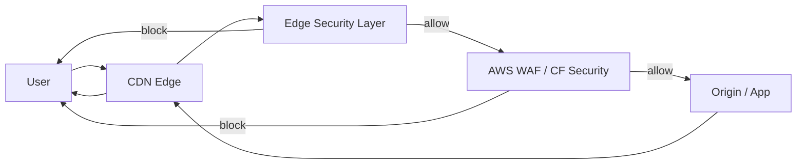
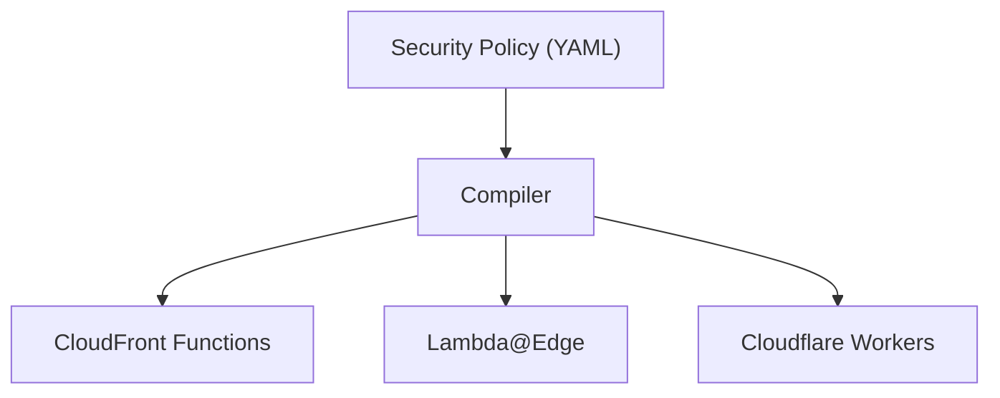

## アーキテクチャ概要

Release scope と capability status の正本は[version roadmap](./ROADMAP.ja.md)です。

本フレームワークは **"Policy → Compile → Runtime"** の三層構造で設計されています。

## プロダクト境界と Evidence

本プロダクトは **Application-aware Edge Security Compiler** です。
アプリケーションが宣言した意図とレビュー済み policy を provider 別の Edge / WAF
artifact に変換します。CDN / WAF の動作やアプリケーション認証認可を再実装しません。
運用の流れは **Generate → Diff → Review → Apply** です。

4つの独立した Truth を分離して扱います。

| Truth | Evidence | 何を示せるか |
| --- | --- | --- |
| Declared | OpenAPI | contract が公開すると宣言したもの |
| Implemented | Source AST / Source IR | 対応済み source syntax が宣言するもの |
| Allowed | Policy と CDN/WAF 設定 | security policy が許可するもの |
| Observed | Runtime evidence | deploy 済み system が実際に出力・受理したもの |

どの Truth も別の Truth の証明とは扱いません。未対応・partial な解析は推測で
補完せず、review 用 finding として報告します。

公開済みは **1.4.0 / Policy schema 1**。2026-10-26に照合したmain `31975ebcf9862ba040905c1a693fe17714b5a5fd`の技術基準は、明示migrationを持つ**未公開2.0.0-rc.0 / Policy schema 2**です。[候補の証拠](https://github.com/albert-einshutoin/cdn-security-framework/issues/1024)。H01 EN/JAは未実施で、RC GOと公開は未達です。

### Capability status

| Capability | Status | Interface | Limit |
| --- | --- | --- | --- |
| OpenAPI inspect | Implemented | CLI/API | local refs only |
| OpenAPI policy candidate | Implemented | CLI/API | review-only; never auto-applied |
| OpenAPI↔Policy drift | Implemented | CLI/JSON/SARIF/GHA | no source needed |
| NestJS Source Analyzer core | Experimental/Implemented core | Programmatic | no app execution; metadata is not enforcement proof |
| Source-aware contract diff CLI | Planned v2.1 | — | — |
| Auth/cache model verification (#1119) | Implemented bounded core | Internal harness | model-only; no deployed authentication proof |
| Cloudflare artifact HTTP verification (#1123) | Implemented local MVP | Internal native HTTP harness | bound artifact/runtime; no live Cloud or AWS cache proof |
| Runtime / Deployment Evidence (#534) | Planned beyond the local MVP | — | Phase B; release version not adopted |
| Policy Composition / Regression Guard (#536) | Planned | — | Phase D; release version not adopted |
| LSP/VS Code (#539) | Optional after GA | — | release version not adopted |

有界model coreとlocal artifact MVPはinternal・未公開の実装であり、public verifier APIやPhase A/B全体の完了ではありません。Deployment検証とprovider同値性はPlannedです。[#1119](https://github.com/albert-einshutoin/cdn-security-framework/issues/1119)と[#1123](https://github.com/albert-einshutoin/cdn-security-framework/issues/1123)に受入範囲を記録し、[#533 → #534 → #1118 → #536](ROADMAP.ja.md#4-version-release-train)で製品採用を判断します。

対応済み interface は [OpenAPI 導入ガイド](openapi-integration.ja.md)、
[NestJS Source Analysis](source-analysis-nestjs.ja.md)、[CLI リファレンス](cli.ja.md)、
[プログラマティック API](programmatic-api.ja.md) を参照してください。
Source-aware contract diff CLI は v2.1 planned のままで、現行 NestJS analyzer は
programmatic かつ static のみです。

---

## 全体フロー



---

## レイヤー別責務

### Edge Security Layer

対象:

* CloudFront Functions
* Cloudflare Workers

責務:

* Method / Path / UA の粗い検査
* クエリ正規化・削除
* 早期遮断（403/400）
* セキュリティヘッダー付与

特徴:

* 超低レイテンシ
* ステートレス

---

### WAF Layer

対象:

* AWS WAF
* Cloudflare WAF

責務:

* レート制限
* OWASP Managed Rules
* Bot / CAPTCHA
* Body 検査

特徴:

* ステートフル
* 高精度

---

### Origin / Application

責務:

* 認証 / 認可
* 業務ロジック
* データ整合性

> 「Edge が壊れても App が最後の砦になる」前提を維持する

---

## ポリシー駆動設計



### ポリシーの役割

* 人がレビューできる
* PR で差分が分かる
* CDN 依存を排除

---

## CDN別実装マッピング

| 概念     | CloudFront Functions | Lambda@Edge     | Cloudflare Workers |
| ------ | -------------------- | --------------- | ------------------ |
| 入口遮断   | Viewer Request       | Origin Request  | fetch()            |
| ヘッダー付与 | Viewer Response      | Origin Response | Response headers   |
| 高度検証   | 不可                   | 可能              | 可能                 |
| 状態管理   | 不可                   | 一部可             | KV / DO            |

---

## セキュリティ設計原則

1. **Fail Fast** – 早く落とす
2. **Least Privilege** – 通さない前提
3. **Defense in Depth** – Edge + WAF + App
4. **Portable Security** – CDN に依存しない

将来の Security Compiler 比較（段階的提供を計画中）は Declared、Implemented、
Allowed、Observed API を対象とし、いずれか1つを常に正とは扱いません。詳細は
[ADR 0003: Security ContractのTrust Model](adr/0003-security-contract-trust-model.ja.md)を参照してください。

---

## よくあるアンチパターン

* Edge だけで全てを守ろうとする
* WAF ルールと Functions が重複
* CSP をいきなり厳格化
* 例外ルールが増殖

---

## この設計が向いているケース

* グローバル配信
* API + 管理画面
* マルチテナント
* OSS / テンプレ配布

---

## 次のステップ

* [threat-model.ja.md](threat-model.ja.md) で攻撃整理
* [decision-matrix.ja.md](decision-matrix.ja.md) で Edge / WAF 判断
* ポリシーとランタイムの同期: [policy-runtime-sync.ja.md](policy-runtime-sync.ja.md)
* 観測: [observability.ja.md](observability.ja.md) でログ・メトリクス仕様
* CI 品質ゲート（policy lint + build + runtime + unit + drift + security-baseline）: `.github/workflows/policy-lint.yml`

## 保存Deployment fixtureのbinding（内部）

`bindHttpArtifactDeployment(snapshot, input)`は既存の内部artifact HTTP
verifierを拡張します。`snapshot`は`captureHttpArtifactSnapshot`が発行した
凍結objectである必要があり、deserializeしたcopyは拒否します。`input`は
保存fixtureのJSON text、receipt未取得なら`undefined`です。配備設定の取得や
providerへの接続は行いません。

入力の正本は`src/contract/verification/artifact-http.ts`の
`HttpDeploymentFixtureInput`です。version 1の形は次のとおりです。

```ts
const input: HttpDeploymentFixtureInput = {
  version: 1,
  scope: 'saved-deployment-fixture',
  expected: {
    resourceIdSha256, deploymentVersionSha256,
    referenceTimeMs: 1000, maxAgeMs: 100,
  },
  receipts: [{
    resourceIdSha256, deploymentVersionSha256,
    artifactId: snapshot.artifactId, capturedAtMs: 950,
  }],
};
const binding = bindHttpArtifactDeployment(snapshot, JSON.stringify(input));
```

2つのidentity変数には生のresource IDでなく小文字SHA-256 hexを渡します。
receiptのidentityは未取得を明示する`null`を許容します。v1の全fieldは必須で、
追加fieldや不正identityは入力Errorです。credential、URL、path、query、body、
生resource IDをこの入力へ持ち込まないでください。

入力上限は8192 UTF-8 bytesとreceipt 8件です。時刻は非負の安全な整数ms、
`maxAgeMs`は最大86400000です。freshnessの両端
`referenceTimeMs - maxAgeMs`と`referenceTimeMs`を含みます。未来時刻、完全に
重複したreceipt、不正scope/JSON/type、未発行snapshotは、生入力を含まない
固定`HttpArtifactError`です。未対応の正のenvelope versionは有界の`unknown`
とし、v1へ読み替えません。

| State | 保存fixture内の意味 |
| --- | --- |
| `missing` | artifact material、receipt、またはreceipt identityが欠落。 |
| `unknown` | 異なるresourceのreceipt、または未対応envelope version。 |
| `mixed` | 対象resourceに複数のdeployment-version/artifact identityが存在。 |
| `stale` | 期待version/artifactと不一致、または取得が古すぎる。 |
| `current` | 必要なidentityと時刻条件がすべて一致。 |

該当する固定reasonはすべて保持します。v1で複数の問題があればstateの優先順は
missing、unknown、mixed、stale、currentです。receipt順や、全identityとreasonを
保つ時刻metadata差はsemantic digestを変えません。freshness境界をまたぐとstaleの
reasonが変わり、集約stateが同じ`stale`や`missing`でもdigestは変わります。
元入力のSHA-256、発行snapshot digest、参照時刻・
window・取得時刻は別metadataに保持し、結果は再帰的に凍結します。

`current`はidentity/timeのbindingだけを表します。Security verdict、実配備の
attestation、認証強制の証明は返しません。保存bindingが`current`でも、既存の
独立HTTP verifierは同じartifactを`VIOLATED`と判定できます。Phase B全体、live
readback、canonical events、readiness、製品採用・公開は別の残件です。

repoのfixtureは次のコマンドで実行します。

```sh
npx --no-install vitest run test/contract/artifact-http.test.ts test/contract/auth-cache.test.ts
```

package barrel export、CLI、workflow、legacy adapter、自動Applyは追加して
いません。この追加のrevertでfixture bindingを戻せます。

## Terraform JSONにおけるWAF ruleデータ

WAF専用compilerは生成rule内の文字列をCloudflareへ渡すデータとして保持します。
共通の出力境界で、[Terraformのescape仕様](https://developer.hashicorp.com/terraform/language/expressions/strings)に従い
`${`と`%{`を`$${`と`%%{`へ変換します。custom/rateの式とnested block response本文を含みます。
たとえばPolicyのpath literal `/${1+1}`は、Terraform JSONでは`/$${1+1}`として出力します。
入力自体に`$${`や`%%{`がある場合も、そのliteralを保持するため追加escapeします。
この境界ではquote・backslash・その他の文字へ追加変換を行いません。

compiler所有のzone/accountやLogpush destinationのTerraform参照形式は保持します。
template markerのないruleの出力も維持します。Free preflightの保守的な入力制約は下記のままで、
未指定経路のUA Unicode/case folding・引用処理は別の境界です。この表現変換はTerraformの
plan/apply、provider受理、実WAFの保護を証明しません。

## Cloudflare Freeの生成前preflight

既存のWAF専用compilerに、明示した場合だけFreeのローカル検査を追加します。

```sh
node scripts/compile-cloudflare-waf.js --policy policy.yml --out-dir review --cloudflare-free
node scripts/compile-cloudflare-waf.js --policy policy.yml --out-dir review --cloudflare-free --cloudflare-free-inventory saved-inventory.json
```

このscriptはWorkerを追加しません。Freeの検査はflag指定時に行い、共通のrule literal表現は
flag未指定時にも適用します。
新flagはこのscript専用で、公開`compileArtifacts` optionや`cdn-security build`
flagとして追加するものではありません。

2026-10-26に[Free custom rules](https://developers.cloudflare.com/waf/custom-rules/)
のzone custom phase全体5ルール・custom ruleset1個・Regex/Log不可と、
[Free rate limiting](https://developers.cloudflare.com/waf/rate-limiting-rules/)
の1ルール・period/mitigation各10秒を確認しました。既存rate validatorの明示閾値と
URI-path式の限定契約を再利用します。
[Bot Management field](https://developers.cloudflare.com/ruleset-engine/rules-language/fields/reference/)
はEnterprise add-onが必要です。
[Logpushは2026-09-30から全planで従量課金付き](https://developers.cloudflare.com/changelog/post/2026-09-30-logpush-usage-based-pricing/)
になったため、含まれる利用枠の有無を推測せず、追加費用0円profileではresourceを拒否します。

対応subsetはcompilerのGeo/ASCII-UA block式、検証済みFree rate rulesと、
明示static profileのliteral Path・Method・edge Port block式です。
[Cloudflareの`lower()`](https://developers.cloudflare.com/ruleset-engine/rules-language/functions/#lower)
はASCIIだけを変換します。非ASCIIのUA literalは、既存JavaScript generatorで既に
小文字化されていても`UA_UNICODE_CASE_UNSUPPORTED`の`unknown`としてFree生成を止めます。
Unicode case foldingの同等性は主張しません。
compilerは変換前のUA literalを確認し、UnicodeからASCIIになる場合も見逃しません。
既存emitterの引用形式がcanonical JSONとして元literalを保持できない場合は、
`UA_LITERAL_ENCODING_UNSUPPORTED`でFree生成を止めます。生成式の共通検証ではcustom/rate双方の
[Terraform template marker](https://developer.hashicorp.com/terraform/language/syntax/json#expression-mapping)を
`EXPRESSION_TEMPLATE_UNSUPPORTED`で拒否します。直接指定したrate式とscope-downから生成した式も対象です。
この入力制約は明示Free modeに適用します。出力は上記の共通literal表現を使います。
式全体の対応形状を確認し、disabled ruleも件数へ含めます。未対応field/function/action、
list、managed phase、resourceは限定`unknown`診断でWAFファイル生成を止めます。
既知のplan違反と容量超過でも生成を止め、`--allow-waf-approximation`では回避できません。
拒否時は既存outputを保持します。検査は生成resourceに限定し、Policy全体のcoverageは
証明しません。通常のWorker用`request.block.path_patterns`はこのcompilerで変換しません。
下記の明示static WAF profileだけが独自literal pathと共通`request.allow_methods`を使い、
`policyCoverage`は引き続き`unknown`を保持します。

任意の保存inventoryは8192 UTF-8 bytes以下のstrict JSONです。

```json
{"version":1,"scope":"saved-cloudflare-free-inventory","capturedAtMs":0,"complete":false,"plan":null,"existingCustomRules":null,"existingRateRules":null}
```

この例はaccount情報が未取得だと明示しています。v1はこのfieldだけをすべて必須とし、
時刻と既知件数は非負の安全な整数、件数上限10000、planは`free`またはnull、件数もnullを
許容します。`complete: true`は対象zoneの該当phase全体を取得したという宣言で、
attestationではありません。未取得・部分・24時間超・plan/count不明・未対応versionから
`savedCapacity: fits`を返しません。未来時刻、不正type/field/JSON/UTF-8、上限超過は
生入力やinventory file pathをechoしない固定Errorです。

stderrのassessmentは生成件数・保存件数/時点/入力SHA-256と固定reasonを示します。
完全・24時間以内・Freeと宣言された保存inventoryではexisting+generatedの追加を仮定して
`savedCapacity`を`fits`/`exceeded`にします。Terraformのownership/import、既存zone ruleを
保持する手順は別途reviewが必要です。不明inventoryでも対応subsetのローカル生成は可能で、
`savedCapacity: unknown`を明記します。保存計算がfitsでも`liveDeployment`は常に`unknown`です。
account entitlement、API受理、実配備、防御、安全性を証明せず、API/credential/applyや
自動的な要件緩和は行いません。`npm run build:ts`の後に
`node scripts/cloudflare-waf-parity-unit-tests.js`で再現できます。


### Workerを追加しないFree静的サイト

`policy/archetypes/cloudflare-free-static-site.yml`は、既存のWorker向け
`spa-static-site.yml`とは別のWAF専用プリセットです。既存側のBusiness rate設定は
維持します。採用前に未使用と宣言するPHP/WP endpointを確認してください。
必要なPHPルートやWP静的資産を一括拒否するものではありません。
`init --archetype`やWorker buildではなく、専用compilerを使います。

```sh
node scripts/compile-cloudflare-waf.js --policy policy/archetypes/cloudflare-free-static-site.yml --cloudflare-free --out-dir review-static
```

任意field `firewall.waf.cloudflare_static_site`の正本は`policy/schema.json`で、
型は同Schemaから生成します。`allow_ports`とliteralの`block_paths.exact`/`prefix`
配列を明示し、pathは少なくとも一方を非空にします。共通`request.allow_methods`も
非空の明示配列が必須です。プリセットはUAとPath・Method・Portの4 custom blockを
生成し、rate ruleとWorkerは生成しません。保存inventoryの枠計算も全4件を含めます。
他のWorker/AWS targetは、このprofileを出力前に拒否します。
Worker/AWS用の`readiness`も、このprofileでは明示したfailを返します。

pathは小文字ASCIIの絶対literal（256文字以下）を`lower(http.request.uri.path)`で
比較します。exact/prefixはliteral一致で、Regex・query照合・URL decode adapterは
ありません。各listは重複なし32件以下、生成式は4096 ASCII bytes以下です。
`block_paths.exceptions`はそのexact pathをpath ruleからだけ除外します。
`method_exceptions`は各exact pathで明示methodを追加するだけです。他のPort/UA blockを
除外せず、`Skip`も生成しません。PortはHost headerの値ではなく、
[`cf.edge.server_port`](https://developers.cloudflare.com/ruleset-engine/rules-language/fields/reference/cf.edge.server_port/)です。
これらのfieldとFree custom rule上限は2026-10-27に確認しました。

Worker条件（`request.block.path_patterns`、normalize、routes、response headerなど）、
monitor mode、AWS scope、不正/未知field、未対応path literalは生成前に拒否します。
必須の`response_headers: {}`は意図的です。WAF専用presetは応答headerを生成しないため、
originや別途reviewしたCloudflare機構で設定してください。Free admissionは必須で、
approximation flagでも検査を回避できません。

テストは生成式と、独立した有限の要件truth tableを合成Rules-language fieldで照合します。
HTTP fixtureの一部入力literalは再利用しますが、Worker結果を期待値にしたり、raw targetから
Cloudflare fieldを推定したりしません。静的subsetの証拠であり、実WAF runtimeではありません。
実URL-normalization設定、encoded targetの対応、provider受理、既存zoneのownership/順序、
配備、port防御効果は`unknown`です。Cloud API・entitlement確認・apply・本番通信は行わず、
セキュリティ効果も主張しません。


### 保存Cloudflare custom-rule subset（internal）

`src/contract/verification/cloudflare-deployment.ts` の
`compareSavedCloudflareWafSubset(contract, snapshot, observations, generatedWafBytes, savedInput)`
は、生成WAFファイルと正規化した合成保存fixtureを比較します。既存HTTP verifierで
発行済みcontract/snapshot/observationsを確認し、既存deployment binderで
resource/version/artifact identityと時刻windowを確認します。provider取得、CLI、
公開barrel export、自動操作は追加していません。

正本は同moduleの `SavedCloudflareWafFixture` 型です。`version: 1`、
`scope: 'saved-cloudflare-waf-subset'`、既存 `HttpDeploymentFixtureInput['expected']` と、
8件以下の `snapshots` を持ちます。各recordは `stage`（plan/apply/observe）、
`sourceSha256`、`httpStatus`（未取得はnull）、`complete`、`missing`
（identity/rules/rule-order/exceptions）、既存receiptのidentity/time、
nullable `policySha256`/`wafArtifactSha256`、`resources`（未取得はnull）を明示します。
すべて必須で、取得元SHAは宣言した保存元の識別子です。`metadata.inputSha256` は
実際に渡したbytesのSHAであり、providerの認証済み証明ではありません。入力2本は
各65536 bytes以下、UTF-8をfatal検査します。生成物はcompilerのTerraform JSON
`resource` と任意 `variable` envelope、保存 `resources` は同resource形状に正規化した
local fixtureです。生のCloudflare REST responseを取り込むAPIではありません。

対応scopeはzoneの `http_request_firewall_custom` ruleset 1件・rule 5件以下と、
既存Free validatorのfield/function/action subsetです。ref有無・配列順序・enabled・
expression literal（局所例外を含む）・action/parametersの差を区別し、式の意味上の
同値性は解釈しません。未対応式/action/parameters、未知ruleset field、他resource
scopeはUNKNOWNです。未解析scopeからrule欠落の根拠を作りません。completeを明示した
空のactual custom scopeは非空の期待ruleとDIFFERENTになり得ますが、期待要件0件を
成功にしません。

各stageは独立したMATCHED/DIFFERENT/UNKNOWNで、plan/applyが一致してもobserveを
補いません。receiptの欠落/stale/mixed、403/失敗/未取得、部分snapshot、明示欠落、
Policy/WAF identity不一致は全既知reasonを保持してUNKNOWNにします。入力なしや
未対応versionでも既知のartifact不完全reasonを失いません。不正JSON/UTF8/type/scope、
余分なraw field、重複ref/receipt、invalid windowと上限超過は固定Errorで停止し、
切り詰めません。既知custom rulesの件数・型・重複refは、未対応field/scopeの
判定より先に必ず検査します。custom ruleset 2件も入力契約の上限超過です。

出力はopaqueなfield/configuration hashと固定差分・reasonに限定し、raw ref/式/
resource/URL/query/body/cookie/credentialをコピーしません。元bytes・取得元・時刻・
発行済みsnapshotのmetadataはsemantic digestと分けます。rule順序とreasonの変化は
semanticへ影響し、identity/reasonが同じwindow内の時刻・receipt順の違いは影響しません。
HTTP channelは既存local-fixture verdict/digest/reason要約をそのまま保持し、
VIOLATED/UNKNOWNを構成一致で覆しません。合成した安全verdictやreadinessへの写像は
なく、`policyCoverage`/`liveDeployment` は常にUNKNOWNです。構成literalの一致は
変換完全性、実WAF、provider受理/entitlement/ownership/全体順序/URL normalization/
防御効果を証明しません。

`npx --no-install vitest run test/contract/cloudflare-deployment.test.ts test/contract/artifact-http.test.ts`
と、`npm run build:ts` 後の `node scripts/cloudflare-http-e2e-tests.js` で再現します。
既存2-service native harnessで実生成WAFファイルを独立したUA rule literalと照合し、
enabled反例、保存403、planのみを検査します。HTTP97/Artifact81と保存構成照合は
別の証拠です。Cloud通信・実payload・apply/deploy・公開verifierを導入しません。
