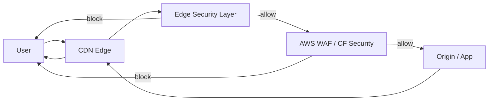
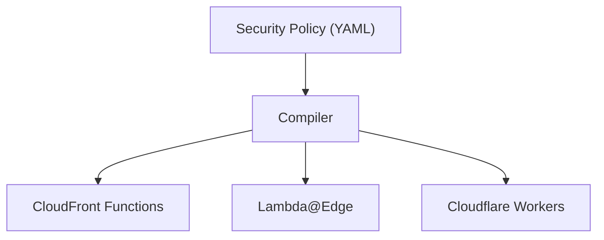

## Architecture Overview

The [version roadmap](./ROADMAP.md) is the canonical source for release scope
and capability status.

This framework is designed with a three-layer structure: **"Policy → Compile → Runtime"**.

## Product Boundary and Evidence

The product is an **Application-aware Edge Security Compiler**. It compiles
declared application intent and reviewed policy into provider-specific edge and
WAF artifacts; it does not reimplement CDN/WAF behavior or application
authorization. The operating loop is **Generate → Diff → Review → Apply**.

Four independent truths are kept separate:

| Truth | Evidence | What it can establish |
| --- | --- | --- |
| Declared | OpenAPI | What the contract says is exposed |
| Implemented | Source AST / Source IR | What supported source syntax declares |
| Allowed | Policy and CDN/WAF configuration | What the security policy permits |
| Observed | Runtime evidence | What a deployed system actually emitted or accepted |

No truth is treated as proof of another. Unsupported or partial analysis is
reported as a finding for review rather than filled in by an assumption.

Published: **1.4.0 / Policy schema 1**. The technical baseline checked on 2026-10-26 at main `31975ebcf9862ba040905c1a693fe17714b5a5fd` is **unpublished 2.0.0-rc.0 / Policy schema 2**, with explicit migration. [Candidate evidence](https://github.com/albert-einshutoin/cdn-security-framework/issues/1024). H01 EN/JA is not performed; RC GO and publication remain pending.

### Capability status

| Capability | Status | Interface | Limit |
| --- | --- | --- | --- |
| OpenAPI inspect | Implemented | CLI/API | local refs only |
| OpenAPI policy candidate | Implemented | CLI/API | review-only; never auto-applied |
| OpenAPI↔Policy drift | Implemented | CLI/JSON/SARIF/GHA | no source needed |
| NestJS Source Analyzer core | Experimental/Implemented core | Programmatic | no app execution; metadata is not enforcement proof |
| Source-aware contract diff CLI | Planned v2.1 | — | — |
| Auth/cache model verification (#1119) | Implemented bounded core | Internal harness | model-only; no deployed authentication proof |
| Cloudflare artifact HTTP verification (#1123) | Implemented local MVP | Internal native HTTP harness | bound artifact/runtime; no live Cloud or AWS cache proof |
| Runtime / Deployment Evidence (#534) | Planned beyond the local MVP | — | Phase B; release version not adopted |
| Policy Composition / Regression Guard (#536) | Planned | — | Phase D; release version not adopted |
| LSP/VS Code (#539) | Optional after GA | — | release version not adopted |

The bounded model core and local artifact MVP are internal, unpublished implementations, not a public verifier API or completion of Phases A/B. Deployment verification and provider equivalence remain planned. [#1119](https://github.com/albert-einshutoin/cdn-security-framework/issues/1119) and [#1123](https://github.com/albert-einshutoin/cdn-security-framework/issues/1123) record the accepted limits; [#533 → #534 → #1118 → #536](ROADMAP.md#4-version-release-train) owns product adoption.

Use the [OpenAPI integration guide](openapi-integration.md), [NestJS source
analysis guide](source-analysis-nestjs.md), [CLI reference](cli.md), and
[Programmatic API](programmatic-api.md) for the supported interfaces. The
Source-aware contract diff CLI remains planned for v2.1; the current NestJS
analyzer is programmatic and static only.

---

## Overall Flow



---

## Layer Responsibilities

### Edge Security Layer

Target:

* CloudFront Functions
* Cloudflare Workers

Responsibilities:

* Coarse inspection of Method / Path / User-Agent
* Query normalization and removal
* Early blocking (403/400)
* Security header injection

Characteristics:

* Ultra-low latency
* Stateless

---

### WAF Layer

Target:

* AWS WAF
* Cloudflare WAF

Responsibilities:

* Rate limiting
* OWASP Managed Rules
* Bot / CAPTCHA
* Body inspection

Characteristics:

* Stateful
* High precision

---

### Origin / Application

Responsibilities:

* Authentication / Authorization
* Business logic
* Data integrity

> Maintain the premise that "even if Edge fails, the App remains the last line of defense"

---

## Policy-Driven Design



### Role of Policy

* Human-reviewable
* Diffs visible in PRs
* CDN-agnostic

---

## CDN Implementation Mapping

| Concept       | CloudFront Functions | Lambda@Edge     | Cloudflare Workers |
| ------------- | -------------------- | --------------- | ------------------ |
| Entry blocking | Viewer Request       | Origin Request  | fetch()            |
| Header injection | Viewer Response      | Origin Response | Response headers   |
| Advanced validation | Not supported        | Supported       | Supported          |
| State management | Not supported        | Partially       | KV / DO            |

---

## Security Design Principles

1. **Fail Fast** – Block early
2. **Least Privilege** – Deny by default
3. **Defense in Depth** – Edge + WAF + App
4. **Portable Security** – CDN-independent

A planned Security Compiler comparison will evaluate declared, implemented,
allowed, and observed API views without treating any one as globally authoritative. See
[ADR 0003: Security Contract Trust Model](adr/0003-security-contract-trust-model.md).

---

## Common Anti-Patterns

* Relying on Edge alone for all protection
* Overlapping WAF rules and Functions
* Tightening CSP abruptly
* Proliferation of exception rules

---

## Use Cases This Design Fits

* Global distribution
* API + admin UI
* Multi-tenant
* OSS / template distribution

---

## Next Steps

* Organize threats in [threat-model.md](threat-model.md)
* Use [decision-matrix.md](decision-matrix.md) for Edge / WAF decisions
* Keep policy and runtimes in sync: [policy-runtime-sync.md](policy-runtime-sync.md)
* Observability: [observability.md](observability.md) for logging and metrics
* CI quality gate (policy lint + build + runtime + unit + drift + security-baseline): `.github/workflows/policy-lint.yml`

## Saved deployment fixture binding (internal)

`bindHttpArtifactDeployment(snapshot, input)` extends the existing internal
artifact HTTP verifier. `snapshot` must be the frozen object issued by
`captureHttpArtifactSnapshot`; a deserialized copy is rejected. `input` is saved
fixture JSON text or `undefined` when no receipt was collected. The module does
not acquire deployment configuration or contact a provider.

The authoritative input type is `HttpDeploymentFixtureInput` in
`src/contract/verification/artifact-http.ts`. Version 1 has this shape:

```ts
const input: HttpDeploymentFixtureInput = {
  version: 1,
  scope: 'saved-deployment-fixture',
  expected: {
    resourceIdSha256, deploymentVersionSha256,
    referenceTimeMs: 1000, maxAgeMs: 100,
  },
  receipts: [{
    resourceIdSha256, deploymentVersionSha256,
    artifactId: snapshot.artifactId, capturedAtMs: 950,
  }],
};
const binding = bindHttpArtifactDeployment(snapshot, JSON.stringify(input));
```

The two identity variables are lowercase SHA-256 hex strings, not raw resource
IDs. Each receipt identity may explicitly be `null` when uncollected. All v1
fields are required; extra fields and malformed identities are input errors.
No credential, URL, path, query, body, or raw resource identifier belongs here.

Input is limited to 8192 UTF-8 bytes and eight receipts. Times are nonnegative
safe integer milliseconds; `maxAgeMs` is at most 86400000. The freshness window
includes both `referenceTimeMs - maxAgeMs` and `referenceTimeMs`. A future
capture, an exact duplicate receipt, an invalid scope/JSON/type, or an unissued
snapshot throws a fixed `HttpArtifactError` without raw input. An unsupported
positive envelope version returns bounded `unknown` and is not decoded as v1.

| State | Meaning within this saved fixture |
| --- | --- |
| `missing` | Artifact material, a receipt, or a receipt identity is missing. |
| `unknown` | A receipt belongs to another resource, or its envelope version is unsupported. |
| `mixed` | The selected resource has multiple deployment-version/artifact identities. |
| `stale` | A version/artifact differs from the expectation, or a receipt is too old. |
| `current` | Every required identity and time condition matches. |

All applicable fixed reasons are retained. For combined v1 problems the state
priority is missing, unknown, mixed, stale, current. Receipt order and time
metadata changes that preserve every identity and reason do not alter the
semantic digest. Crossing the freshness boundary changes the stale reason and
digest even when the aggregate state remains `stale` or `missing`.
The original input SHA-256, issued snapshot digest, reference/window and capture
times remain separate metadata. Results are recursively frozen.

`current` describes identity/time binding only. It does not return a security
verdict, attest to a real deployment, or establish authentication enforcement.
The existing independent HTTP verifier can still return `VIOLATED` for an
artifact whose saved binding is `current`. Phase B, live readback, canonical
events, readiness, product adoption and publication remain separate work.

Run the repository fixtures with:

```sh
npx --no-install vitest run test/contract/artifact-http.test.ts test/contract/auth-cache.test.ts
```

This entry has no package barrel export, CLI, workflow, legacy adapter, or
automatic application. Reverting this addition removes the fixture binding.

## Cloudflare Free generation preflight

The WAF-only compiler offers an explicit, local Free preflight:

```sh
node scripts/compile-cloudflare-waf.js --policy policy.yml --out-dir review --cloudflare-free
node scripts/compile-cloudflare-waf.js --policy policy.yml --out-dir review --cloudflare-free --cloudflare-free-inventory saved-inventory.json
```

This invokes the existing WAF compiler and does not add a Worker. Without these
flags, the existing compiler path is unchanged. The flags belong to this script;
they are not new public `compileArtifacts` options or `cdn-security build` flags.

Checked on 2026-10-26: [Free custom rules](https://developers.cloudflare.com/waf/custom-rules/)
allow five rules across the zone's custom phase, one custom ruleset, and no Regex
or Log action. [Free rate limiting](https://developers.cloudflare.com/waf/rate-limiting-rules/)
allows one rule with a ten-second period and mitigation; the existing rate
validator still enforces its explicit threshold and URI-path expression subset.
[Bot Management fields](https://developers.cloudflare.com/ruleset-engine/rules-language/fields/reference/)
require an Enterprise add-on. [Logpush changed on 2026-09-30](https://developers.cloudflare.com/changelog/post/2026-09-30-logpush-usage-based-pricing/)
to availability on all plans with usage pricing, so this zero-additional-cost
profile rejects Logpush resources even when an account might have included usage.

The initial local subset accepts the compiler's Geo/ASCII-UA block expressions
and validated Free rate rules. [Cloudflare `lower()`](https://developers.cloudflare.com/ruleset-engine/rules-language/functions/#lower)
folds ASCII only. Non-ASCII UA literals return `unknown` with
`UA_UNICODE_CASE_UNSUPPORTED` and stop Free generation, including literals that
the existing JavaScript generator already lowercased. This profile makes no
Unicode case-folding equivalence claim. The compiler checks the original UA
literal before case conversion, so Unicode-to-ASCII mappings cannot bypass the
restriction. If the existing emitter cannot preserve a literal in canonical
JSON quoting, Free generation stops with `UA_LITERAL_ENCODING_UNSUPPORTED`.
The shared emitted-expression check rejects [Terraform template markers](https://developer.hashicorp.com/terraform/language/syntax/json#expression-mapping)
in both custom and rate rules with `EXPRESSION_TEMPLATE_UNSUPPORTED`, including
direct rate expressions and generated scope-down expressions. These rejections do not change the
unflagged emitter. The preflight checks whole supported shapes and
counts disabled rules too. Unsupported fields, functions, actions, lists,
managed phases or resources return bounded `unknown` diagnostics and stop WAF
file generation. Known plan violations and capacity excess also stop generation;
`--allow-waf-approximation` cannot bypass this check. Existing output is preserved
on rejection. This checks generated resources, not complete Policy coverage:
Path/Method controls remain Worker-only in this compiler until separately
implemented, and `policyCoverage` stays `unknown`.

The optional saved inventory is strict JSON, at most 8192 UTF-8 bytes:

```json
{"version":1,"scope":"saved-cloudflare-free-inventory","capturedAtMs":0,"complete":false,"plan":null,"existingCustomRules":null,"existingRateRules":null}
```

This example deliberately declares no account knowledge. Version 1 requires
exactly these fields. Times and known counts are safe nonnegative integers;
counts are at most 10000. `plan` is `free` or null, and either count may be null.
`complete: true` declares collection of the entire selected zone's corresponding
phases; it is not an attestation. Missing/partial/older-than-24-hour inventories,
unknown plan/counts and unsupported versions cannot produce `savedCapacity: fits`.
Future times, invalid types/fields/JSON/UTF-8 and oversized files are fixed input
errors. Raw input and inventory file paths are not echoed in those errors.

The stderr assessment reports generated counts, saved counts/time/input SHA-256,
and fixed reasons. For a complete fresh declared-Free inventory, `savedCapacity`
adds existing and generated counts and reports `fits` or `exceeded`. This is
append arithmetic only: Terraform ownership/import and preservation of existing
zone rules must be reviewed separately. Unknown inventory may still allow local
generation of the supported subset, with `savedCapacity: unknown`.
`liveDeployment` is always `unknown`, including when the saved arithmetic fits.
No account entitlement, API acceptance, actual deployment, protection or safety
is established. No API, credential, apply or automatic security relaxation is
performed. Reproduce with `npm run build:ts` then
`node scripts/cloudflare-waf-parity-unit-tests.js`.
